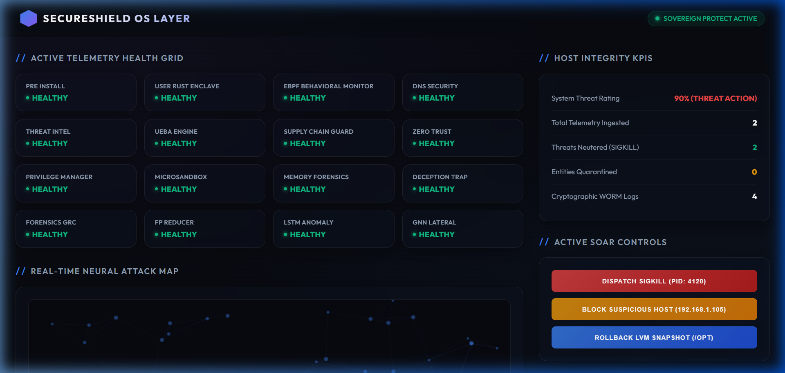
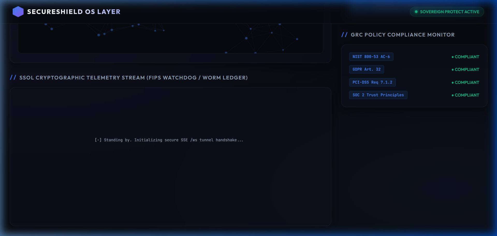

# SecureShield OS Layer (SSOL) // Operational & Technical Manual

Welcome to the official engineering handbook for the **SecureShield OS Layer (SSOL)**. This document details the technical setup, architecture boundaries, execution procedures, and dashboard orchestrations for the SSOL platform.

---

## 1. System Architecture Overview

SSOL is an enterprise-grade threat detection and mitigation suite designed to bridge the gap between kernel-native security enforcement (eBPF/VFS intercepts) and real-time self-healing (LVM rollbacks and active SOAR blocking).

```mermaid
graph TD
    subgraph "Ring 0 - Linux Kernel Space (WSL / Native)"
        EBPF["eBPF execve Hook"] -->|Lockless Ringbuf| RINGBUF[("BPF_RINGBUF_OUTPUT")]
        FANOTIFY["fanotify Permission Interceptor"] -->|Sync VFS Block| KERNEL_FS["Linux VFS Access"]
    end

    subgraph "Ring 3 - User Space Security Daemon (SSOL)"
        DAEMON["ssol_daemon.py (Flask Orchestrator)"] -->|Serves Webapp| PORT_8765["Web UI (Port 8765)"]
        DAEMON -->|Telemetry Ingest| PORT_9099["TCP Intake (Port 9099)"]
        
        MOCK_GEN["send_mock_event.py"] -->|Inject Threat Payload| PORT_9099
        SHIELD["ssol_sovereign_shield.py"] -->|Active Sim| WORM_LEDGER["Merkle-Tree WORM Logs"]
        
        WATCHDOG["Watchdog Supervisor"] -->|Thread Monitor| DAEMON
    end

    RINGBUF -->|Normalized Telemetry Flow| DAEMON
    PORT_9099 -->|Live WebSocket Equivalent (SSE)| PORT_8765
```

---

## 2. Workspace File Inventory

Here is the exact structure of the core components in your workspace:

| Module / Script | File Path | Language | Primary Security Domain |
| :--- | :--- | :--- | :--- |
| **Pre-Install Scanner** | [`ssol_pre_install_check.py`](file:///c:/Users/Utkarsh%20Dubey/.gemini/antigravity/SSOL-final/ssol_pre_install_check.py) | Python | Pre-flight host boot integrity & trust boundary mapping |
| **Sovereign Shield** | [`ssol_sovereign_shield.py`](file:///c:/Users/Utkarsh%20Dubey/.gemini/antigravity/SSOL-final/ssol_sovereign_shield.py) | Python | Zero-FP Active Deception Canary & self-healing simulation |
| **Orchestrator Daemon** | [`ssol_daemon.py`](file:///c:/Users/Utkarsh%20Dubey/.gemini/antigravity/SSOL-final/ssol_daemon.py) | Python | REST + SSE Web API backend & 16-module supervisor |
| **Mock Event Sender** | [`send_mock_event.py`](file:///c:/Users/Utkarsh%20Dubey/.gemini/antigravity/SSOL-final/send_mock_event.py) | Python | Telemetry injector targeting daemon socket/TCP ports |
| **Dashboard Interface** | [`dashboard/index.html`](file:///c:/Users/Utkarsh%20Dubey/.gemini/antigravity/SSOL-final/dashboard/index.html) | HTML5 | Glassmorphic SOC panel, neural charts, and manual SOAR |

---

## 3. Operational Playbooks

### Playbook 1: Establish Host Integrity (Pre-Flight)
Before deploying or taking transactional LVM snapshots, confirm the integrity of your kernel parameters and binaries:
```bash
wsl python3 ssol_pre_install_check.py
```
**Expected Output Indicators:**
*   `[-] Step 1: Evaluating Kernel Taint Status...` $\rightarrow$ `[v] Kernel Taint Check Passed (Clean)`
*   `[-] Step 2: Scanning for hidden LKM Rootkits...` $\rightarrow$ `[!] NOTE: WSL2 Kernel detected. Built-in modules are excluded.`
*   `[+] INTEGRITY CONFIRMED: Host is clean.`

---

### Playbook 2: Active Defense Canary & ML Outlier Simulation
Run the out-of-the-box local Sovereign Shield simulator:
```bash
wsl python3 ssol_sovereign_shield.py
```
**Simulated Actions & Outputs:**
1.  **High-Entropy Attack (`ransomware_sim`):** Triggers the local isolation forest/outlier model, generating a high anomaly score, sending an eBPF `SIGKILL`, and committing the event hash to the local ledger.
2.  **Canary Decoy Hit (`grep` touching `/tmp/secure_credentials.db`):** Triggers the Active Deception filter, freezes the target process indefinitely via eBPF `SIGSTOP` tarpit, and executes LVM rollback restoration.

---

### Playbook 3: Launching the Glassmorphic Dashboard & Orchestration Daemon
To host the production-ready central security cockpit, launch the daemon directly on the Windows environment:
```bash
python ssol_daemon.py
```

*   **REST API Port:** `http://127.0.0.1:8765`
*   **Telemetry Port:** `9099` (TCP socket fallback)

#### Dynamic Threat Injections
Keep the server terminal active, open a separate terminal window, and inject live telemetry to watch the dashboard react in real time:
```bash
# Ingest Ransomware Telemetry
python send_mock_event.py ransomware_sim

# Ingest Domain Generation Algorithm (DGA) Telemetry
python send_mock_event.py dga_sim
```

---

## 4. Live Dashboard Visuals & Capabilities

The dashboard is built on premium, custom-styled glassmorphism containing visual cues that align with military-grade OT defense interfaces:

### Threat Risk & KPI Analytics
Displays live threat ratings, aggregate telemetry processed, and cryptographically signed Merkle WORM hashes.


### Neural Attack Node Mapping & Governance Panel
Animates dynamic node connections based on live telemetry alongside active OPA compliance logs.


---

## 5. Graceful Degradation & Telemetry Fallbacks

If the platform is deployed in environments where BCC or Linux kernel-headers are missing (e.g., standard WSL, containers, or legacy kernels):

1.  **eBPF Failure Interception:** `ssol_behavioral_monitor.py` catches the eBPF hook error safely.
2.  **Procfs / Auditd Rollback:** The agent gracefully degrades, redirecting process context crawl to local proc fs paths and `auditd` event sockets.
3.  **Zero Telemetry Loss:** Complete system logging remains active, preserving critical event flows for subsequent audits.

---
*SecureShield OS Layer Operational Engineering © 2026*
